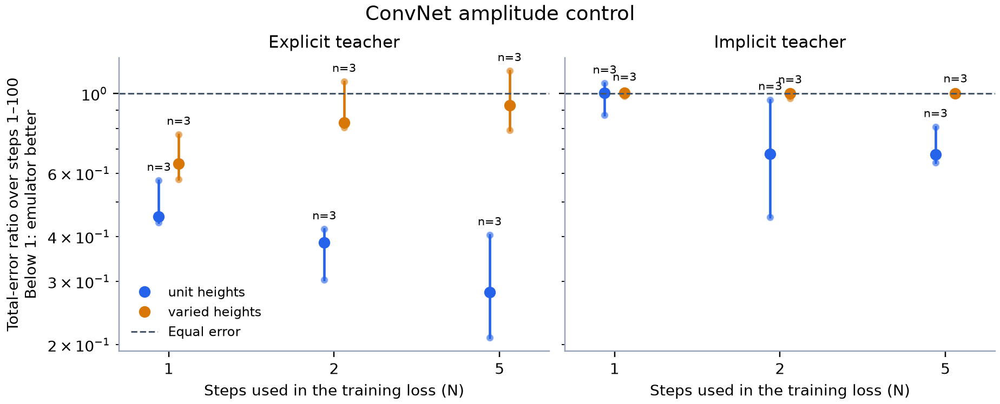
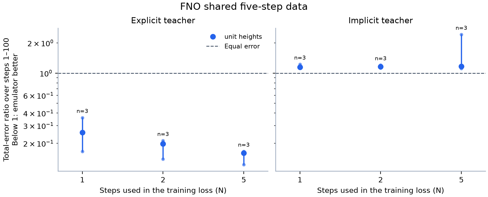
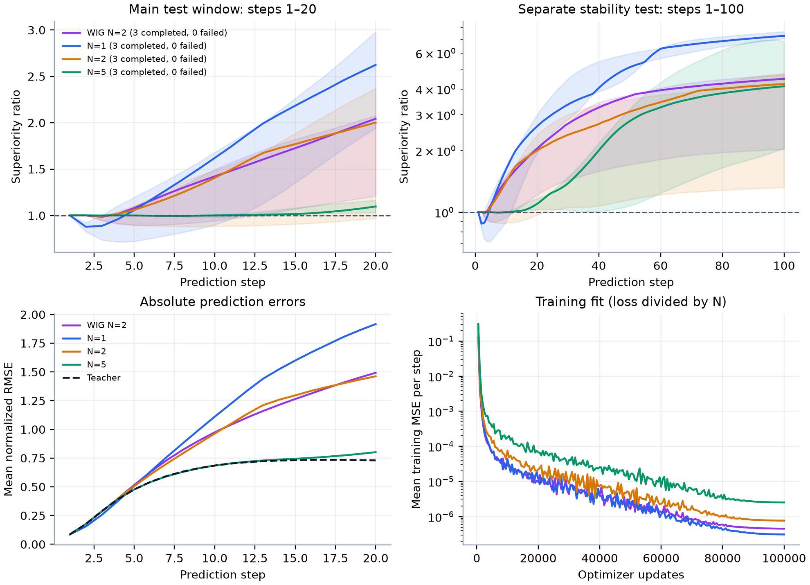
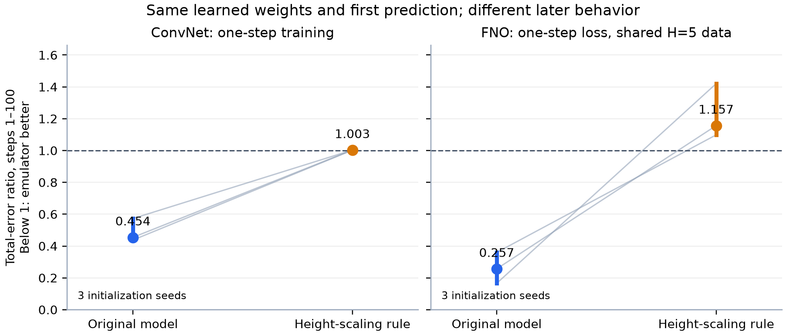
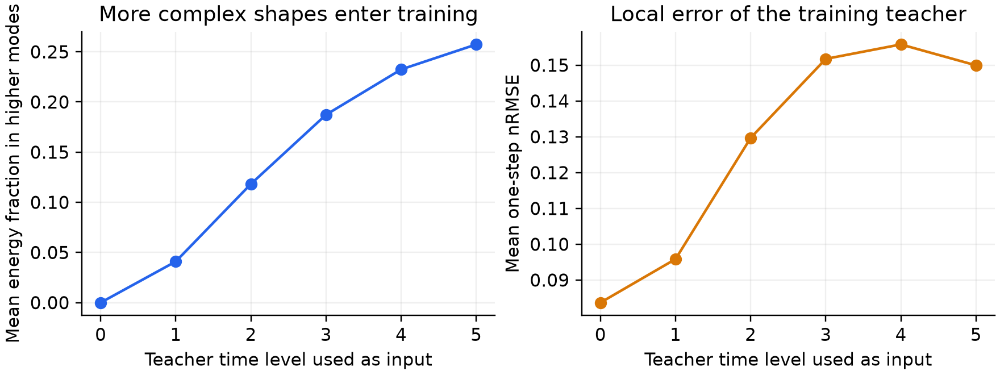
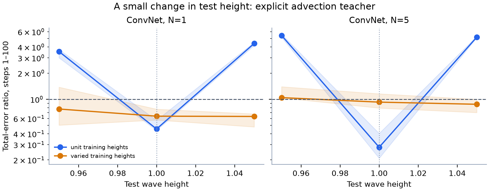

# Extension results: amplitude controls and nonlinear Burgers

Generated from completed run artifacts. Ratios below 1 favor the emulator.

## Completion and provenance

- Newly trained, evaluated configurations: **67**, including one runtime calibration.
- Historical configurations retained separately: **137**.
- The historical cohort is not pooled with the new cohort. Same nominal seed/configuration does not guarantee the same trained network across dependency versions.
- Main comparisons use common data and initialization seeds within the new environment. Three initialization seeds measure initialization variability, not dataset uncertainty.
- Full method and hypotheses: `../../EXPERIMENT_PLAN.md`. Raw per-run data: `per_run_results.csv`; paired contrasts: `paired_seed_contrasts.csv`.

| Study | Completed | Planned |
|---|---:|---:|
| ConvNet amplitude control | 36 | 36 |
| FNO shared five-step data | 18 | 18 |
| UNet Burgers | 12 | 12 |

## Main findings

- The full study completed 66 prescribed configurations, each at its full training budget, plus one separate runtime calibration. All rollouts remained finite. Lower error ratios favor the emulator; a ratio of 1 means equal error to the teacher.
- The ConvNet result depends on wave-height coverage. With the explicit teacher, increasing N from 1 to 5 lowers the fixed-height median ratio from 0.454 to 0.280, but raises the varied-height ratio from 0.639 to 0.927. A 5% test-height change exposes much larger errors in the fixed-height models.
- Holding FNO training trajectories fixed does not remove the explicit-teacher unrolling trend: median ratios are 0.257, 0.197, and 0.160 for N=1,2,5. Every paired seed improves. With the implicit teacher, all nine models instead have ratios above 1.
- On nonlinear Burgers, five-step training reduces the median 20-step ratio from 1.893 to 1.015. This is a large improvement over the one-step emulator, but none of the three five-step models beats the teacher on the primary normalized-error score. Solver-in-loop training adds no consistent benefit over ordinary two-step training.
- An identical-weight scaling intervention removes the large advantage of unit-height explicit ConvNets: for N=1 the median ratio changes from 0.454 to 1.003 while the first prediction is unchanged. Common-target validation also shows that Burgers five-step models copy later teacher states far better than one-step models. These are useful mechanism checks, with narrower scope than a universal superiority claim.

## Experiment 1A: Does amplitude diversity change the ConvNet advantage?

**Question.** Does the report’s amplitude explanation also hold for a local convolutional network when it is trained over multiple prediction steps?

**Design.** Both advection teachers; fixed height 1 versus uniform heights 0.5–1.5; N=1,2,5; three initialization seeds; 10,000 Adam updates and batch 32. H=N follows the midway protocol. The test set is the same 10 unit-height waves. There are 100 periodic grid points; explicit upwind uses CFL 0.9 and implicit upwind uses CFL 3.0, each evaluated against its exact advection solution. The different CFL values also mean different elapsed physical times per step; this is not an isolated causal comparison of explicit versus implicit integration.

**Primary score.** Total mean RMSE over prediction steps 1–100, divided by the teacher’s corresponding total error. Reported as median [minimum, maximum] across seeds.

| solver   | amplitudes   |   N |   n | R100                 | s100                 | seeds with primary < 1   |
|:---------|:-------------|----:|----:|:---------------------|:---------------------|:-------------------------|
| explicit | unit         |   1 |   3 | 0.454 [0.438, 0.573] | 0.339 [0.308, 0.465] | 3/3                      |
| explicit | unit         |   2 |   3 | 0.385 [0.303, 0.419] | 0.266 [0.230, 0.299] | 3/3                      |
| explicit | unit         |   5 |   3 | 0.280 [0.209, 0.404] | 0.245 [0.119, 0.373] | 3/3                      |
| explicit | varied       |   1 |   3 | 0.639 [0.577, 0.769] | 0.587 [0.584, 0.835] | 3/3                      |
| explicit | varied       |   2 |   3 | 0.830 [0.805, 1.080] | 0.822 [0.804, 1.130] | 2/3                      |
| explicit | varied       |   5 |   3 | 0.927 [0.793, 1.157] | 0.963 [0.743, 1.395] | 2/3                      |
| implicit | unit         |   1 |   3 | 1.006 [0.873, 1.068] | 1.118 [0.856, 1.172] | 1/3                      |
| implicit | unit         |   2 |   3 | 0.679 [0.453, 0.961] | 0.825 [0.429, 1.044] | 3/3                      |
| implicit | unit         |   5 |   3 | 0.677 [0.644, 0.808] | 0.709 [0.588, 0.786] | 3/3                      |
| implicit | varied       |   1 |   3 | 1.006 [0.983, 1.020] | 0.996 [0.966, 1.021] | 1/3                      |
| implicit | varied       |   2 |   3 | 1.002 [0.972, 1.003] | 1.004 [0.914, 1.023] | 1/3                      |
| implicit | varied       |   5 |   3 | 1.003 [0.991, 1.009] | 0.974 [0.953, 1.006] | 1/3                      |

Wave-height diversity reverses the explicit-teacher unrolling trend: fixed-height medians improve from 0.454 to 0.385 to 0.280, while varied-height medians move toward the teacher at 0.639, 0.830, and 0.927. Diversity weakens rather than eliminates every advantage: all three varied-height N=1 models still beat the explicit teacher. For the implicit teacher, varied-height medians remain within 0.7% of 1 at every N, whereas fixed-height N=2 and N=5 give medians 0.679 and 0.677. Thus the result depends on training coverage, architecture, and teacher setting.

**Interpretation boundary.** A median improvement is not a seed-robust improvement if the range crosses 1. A weaker effect after varied-height training is evidence against a general superiority claim, but does not prove no individual trained network can improve.

## Experiment 1B: Is the effect due to unrolling or to extra training states?

**Question.** In the original H=N study, a longer loss also supplied longer teacher trajectories. Does the unroll-length effect remain when the underlying trajectories are fixed?

**Design.** FNO, unit-height waves, H=5 for every recipe, N=1,2,5, both teachers, three initialization seeds, and identical update count/schedule. N=1 and N=2 sample all sliding windows of the same trajectories. The number of windows and the weights assigned to time levels still differ; this is not an identical-window experiment.

| solver   |   N |   n | R100                 | s100                 | seeds with primary < 1   |
|:---------|----:|----:|:---------------------|:---------------------|:-------------------------|
| explicit |   1 |   3 | 0.257 [0.166, 0.360] | 0.147 [0.117, 0.225] | 3/3                      |
| explicit |   2 |   3 | 0.197 [0.139, 0.212] | 0.121 [0.095, 0.124] | 3/3                      |
| explicit |   5 |   3 | 0.160 [0.122, 0.166] | 0.086 [0.080, 0.113] | 3/3                      |
| implicit |   1 |   3 | 1.148 [1.116, 1.222] | 1.091 [1.079, 1.105] | 0/3                      |
| implicit |   2 |   3 | 1.160 [1.126, 1.203] | 1.093 [1.082, 1.103] | 0/3                      |
| implicit |   5 |   3 | 1.171 [1.113, 2.421] | 1.096 [1.077, 2.623] | 0/3                      |

The explicit-teacher advantage strengthens with N even when all recipes see the same underlying five-step trajectories: every paired seed improves from N=1 to N=2 to N=5. Extra trajectory coverage alone therefore cannot explain this trend. The implicit-teacher medians are 1.148, 1.160, and 1.171, and none of its nine models beats the teacher. The N=5 range reaches 2.421, showing meaningful initialization variation. Sampling weights, minibatch noise, and compute remain different, so this is not a perfectly isolated loss-only comparison.

## Experiment 2: Does UNet superiority survive nonlinear evolution?

**Question.** Does the emulator repeatedly outperform its teacher on Burgers, and does multi-step or solver-in-loop training change short-term accuracy and longer stability?

**Design.** The paper’s 27,193-parameter UNet, 60 points, one-Picard-step teacher, converged-Picard reference, 500 training examples, 100,000 Adam updates, batch 32, peak learning rate 0.0003, 5,000 warmup updates. Supervised N=1,2,5 and WIG N=2 each use seeds 0/1/2. Training/test/shuffle data seeds are 10/20/30. Diffusion/convection difficulties are 0.2/-8 in APEBench units. The initial profiles have the first Fourier mode and a mean offset, normalized to maximum absolute height 1; broad initial-condition or parameter generalization is not tested. No model or hyperparameter is selected on test superiority.

**Primary score.** Total mean nRMSE over steps 1–20, divided by the teacher’s total. The test has 100 fixed held-out examples; steps 21–100 are a distinct stability extension. The paper text specifies 100 test examples/20 steps; its released script uses 20/10. Our choice follows the text and explicitly documents the difference.

| mode    |   N |   n | R20                  | s3                   | s5                   | s10                  | s20                  | R100                 | s100                 | seeds with primary < 1   |
|:--------|----:|----:|:---------------------|:---------------------|:---------------------|:---------------------|:---------------------|:---------------------|:---------------------|:-------------------------|
| div_wig |   2 |   3 | 1.553 [1.023, 1.609] | 0.987 [0.949, 0.991] | 1.082 [0.898, 1.095] | 1.422 [0.943, 1.497] | 2.044 [1.210, 2.078] | 3.362 [1.628, 3.431] | 4.488 [2.031, 4.713] | 0/3                      |
| sup     |   1 |   3 | 1.893 [1.190, 1.931] | 0.889 [0.736, 1.004] | 1.058 [0.721, 1.197] | 1.621 [0.900, 1.681] | 2.624 [1.944, 2.983] | 4.975 [4.496, 5.298] | 7.279 [7.044, 7.635] | 0/3                      |
| sup     |   2 |   3 | 1.585 [0.911, 1.650] | 0.995 [0.943, 0.997] | 1.061 [0.895, 1.105] | 1.406 [0.884, 1.486] | 2.002 [0.970, 2.371] | 3.139 [1.138, 3.289] | 4.234 [1.320, 4.767] | 1/3                      |
| sup     |   5 |   3 | 1.015 [1.011, 1.056] | 1.000 [1.000, 1.002] | 1.001 [0.999, 1.001] | 1.001 [0.985, 1.005] | 1.098 [1.030, 1.166] | 2.612 [1.291, 3.645] | 4.126 [2.047, 6.843] | 0/3                      |

Absolute errors (mean over steps 1–20; median [min,max] across seeds):

| mode    |   N |   n | emulator_error_mean_20   | solver_error_mean_20   | teacher_validation_loss       | seeds with primary < 1   |
|:--------|----:|----:|:-------------------------|:-----------------------|:------------------------------|:-------------------------|
| div_wig |   2 |   3 | 0.917 [0.604, 0.950]     | 0.590 [0.590, 0.590]   | 2.01e-06 [1.90e-06, 2.11e-06] | 0/3                      |
| sup     |   1 |   3 | 1.118 [0.703, 1.140]     | 0.590 [0.590, 0.590]   | 8.91e-07 [7.78e-07, 1.11e-06] | 0/3                      |
| sup     |   2 |   3 | 0.936 [0.538, 0.974]     | 0.590 [0.590, 0.590]   | 3.56e-06 [3.20e-06, 3.80e-06] | 1/3                      |
| sup     |   5 |   3 | 0.599 [0.597, 0.623]     | 0.590 [0.590, 0.590]   | 2.16e-05 [2.10e-05, 3.00e-05] | 0/3                      |

`teacher_validation_loss` above evaluates each recipe’s own objective on independent teacher-generated validation trajectories. Different recipes use different losses, so these values are not a common cross-recipe fit metric. The frozen-model diagnostic below supplies identical one-step states and targets.

Tightening reference tolerance from 1e-5 to 1e-7 and the iteration cap from 100 to 200 changed the primary ratio by at most **5.36442e-05** among completed models.

Median primary ratios are 1.893 (N=1), 1.585 (N=2), 1.015 (N=5), and 1.553 (solver-guided N=2). Ordinary N=2 improves all three paired one-step models, but only one seed beats the teacher; no other recipe does so on this primary score. Over 100 steps, the corresponding medians are 4.975, 3.139, 2.612, and 3.362. Solver-guided N=2 is worse than ordinary N=2 over 100 steps for every paired seed. Five-step training improves the median but is not the best long-rollout choice for every seed. Near equality for N=5 is metric-sensitive: its median absolute-RMSE ratio is 0.999, versus 1.015 with normalized RMSE. The defensible conclusion is improved emulation and reduced error growth, without consistent teacher superiority in this setup.

**Interpretation boundary.** A favorable step 3 or 5 is a transient advantage; it does not establish a lower total error over steps 1–20. Worse teacher-imitation fit is an alternative explanation for a worse unrolled result. H=N also changes the training states, so this Burgers comparison alone does not isolate the loss. The converged reference solves the same discretized system; it is not an exact continuum PDE solution.

## Additional mechanism check: remove height-dependent feedback without retraining

**Question.** Does superiority survive if the same trained model is forced to scale its prediction in proportion to the wave height, as the linear equation does?

**Intervention.** On linear advection only, use f_hom(u)=a f(u/a), where a is the maximum absolute input height. The weights and first prediction on the unit-height test inputs stay fixed. This is a post-training diagnostic; it is not a new learned model and is not applied to nonlinear Burgers.

| arch   | solver   |   N |   H | heights   |   n | original R100        | height-scaled R100     |   max first-step difference |
|:-------|:---------|----:|----:|:----------|----:|:---------------------|:-----------------------|----------------------------:|
| Conv   | explicit |   1 |   1 | unit      |   3 | 0.454 [0.438, 0.573] | 1.003 [1.003, 1.003]   |                           0 |
| Conv   | explicit |   1 |   1 | varied    |   3 | 0.639 [0.577, 0.769] | 0.634 [0.579, 0.750]   |                           0 |
| Conv   | explicit |   2 |   2 | unit      |   3 | 0.385 [0.303, 0.419] | 1.017 [1.016, 1.031]   |                           0 |
| Conv   | explicit |   2 |   2 | varied    |   3 | 0.830 [0.805, 1.080] | 0.830 [0.800, 1.008]   |                           0 |
| Conv   | explicit |   5 |   5 | unit      |   3 | 0.280 [0.209, 0.404] | 1.190 [1.132, 1.272]   |                           0 |
| Conv   | explicit |   5 |   5 | varied    |   3 | 0.927 [0.793, 1.157] | 0.923 [0.801, 1.163]   |                           0 |
| Conv   | implicit |   1 |   1 | unit      |   3 | 1.006 [0.873, 1.068] | 1.000 [1.000, 1.000]   |                           0 |
| Conv   | implicit |   1 |   1 | varied    |   3 | 1.006 [0.983, 1.020] | 0.998 [0.998, 0.998]   |                           0 |
| Conv   | implicit |   2 |   2 | unit      |   3 | 0.679 [0.453, 0.961] | 1.011 [1.008, 1.015]   |                           0 |
| Conv   | implicit |   2 |   2 | varied    |   3 | 1.002 [0.972, 1.003] | 1.000 [0.998, 1.000]   |                           0 |
| Conv   | implicit |   5 |   5 | unit      |   3 | 0.677 [0.644, 0.808] | 1.017 [1.014, 1.021]   |                           0 |
| Conv   | implicit |   5 |   5 | varied    |   3 | 1.003 [0.991, 1.009] | 0.999 [0.997, 0.999]   |                           0 |
| FNO    | explicit |   1 |   5 | unit      |   3 | 0.257 [0.166, 0.360] | 1.157 [1.098, 1.420]   |                           0 |
| FNO    | explicit |   2 |   5 | unit      |   3 | 0.197 [0.139, 0.212] | 1.245 [1.203, 1.498]   |                           0 |
| FNO    | explicit |   5 |   5 | unit      |   3 | 0.160 [0.122, 0.166] | 1.304 [1.244, 1.493]   |                           0 |
| FNO    | implicit |   1 |   5 | unit      |   3 | 1.148 [1.116, 1.222] | 1.001 [1.001, 1.002]   |                           0 |
| FNO    | implicit |   2 |   5 | unit      |   3 | 1.160 [1.126, 1.203] | 1.002 [1.001, 1.002]   |                           0 |
| FNO    | implicit |   5 |   5 | unit      |   3 | 1.171 [1.113, 2.421] | 1.002 [1.002, 1.3e+04] |                           0 |

For unit-height explicit ConvNets, enforcing proportional scaling changes median ratios from 0.454, 0.385, and 0.280 to 1.003, 1.017, and 1.190 for N=1,2,5, with exactly unchanged first predictions. For the shared-data explicit FNO N=1 model, the median changes from 0.257 to 1.157. This supports height-dependent behavior away from the training manifold as a major source of the large benchmark advantage. It does not explain all residual gains: diversified explicit ConvNets retain similar scores after scaling. Enforcing scaling can also amplify finite fitting errors; one implicit FNO N=5 intervention has ratio approximately 13,263. Full intervention outcomes are retained in homogeneity_results.csv and RESULTS.md.

## What extra teacher states does Burgers unrolling expose?

This analysis uses the same 500 teacher-generated training trajectories, without using neural test outcomes. Higher-mode energy measures how much the shape departs from its initial smooth single-wave form. The local gap applies both teacher and converged reference to the very same state.

|   teacher_time |   samples |   mean_higher_mode_energy_fraction |   median_higher_mode_energy_fraction |   mean_one_step_teacher_reference_nRMSE |   median_picard_iterations_to_reference_tolerance |   max_picard_iterations |
|---------------:|----------:|-----------------------------------:|-------------------------------------:|----------------------------------------:|--------------------------------------------------:|------------------------:|
|              0 |       500 |                        5.10423e-14 |                          5.24898e-15 |                               0.0836929 |                                                22 |                      35 |
|              1 |       500 |                        0.0409844   |                          0.0441598   |                               0.0958532 |                                                30 |                      44 |
|              2 |       500 |                        0.118228    |                          0.1336      |                               0.129688  |                                                33 |                      48 |
|              3 |       500 |                        0.187246    |                          0.221519    |                               0.151745  |                                                34 |                      47 |
|              4 |       500 |                        0.232398    |                          0.280292    |                               0.155778  |                                                32 |                      44 |
|              5 |       500 |                        0.257326    |                          0.311442    |                               0.149944  |                                                30 |                      40 |

## Secondary test: ±5% changes in test wave height

These test heights were fixed in the runner before training. The same trained models are compared with correctly rescaled teacher and reference trajectories. This extends the report’s amplitude stress test to the fresh multi-step ConvNet study.

|   N | training_heights   |   test_height |   n | R100                 |
|----:|:-------------------|--------------:|----:|:---------------------|
|   1 | unit               |          0.95 |   3 | 3.555 [3.004, 3.755] |
|   1 | unit               |          1    |   3 | 0.454 [0.438, 0.573] |
|   1 | unit               |          1.05 |   3 | 4.391 [4.171, 4.525] |
|   1 | varied             |          0.95 |   3 | 0.772 [0.503, 1.379] |
|   1 | varied             |          1    |   3 | 0.639 [0.577, 0.769] |
|   1 | varied             |          1.05 |   3 | 0.634 [0.480, 0.678] |
|   5 | unit               |          0.95 |   3 | 5.439 [5.185, 5.621] |
|   5 | unit               |          1    |   3 | 0.280 [0.209, 0.404] |
|   5 | unit               |          1.05 |   3 | 5.192 [5.127, 5.313] |
|   5 | varied             |          0.95 |   3 | 1.045 [1.038, 1.395] |
|   5 | varied             |          1    |   3 | 0.927 [0.793, 1.157] |
|   5 | varied             |          1.05 |   3 | 0.876 [0.703, 0.998] |

## Secondary Burgers metric and per-example checks

Absolute RMSE changes how examples are weighted relative to normalized RMSE. These are secondary diagnostics and do not replace the predefined primary score. The per-example win fraction is computed within each trained model; the 100 test examples are shared across seeds and must not be counted as 300 independent examples.

| name                                                              | mode    |   N |   seed |   nRMSE_R20 |   absolute_RMSE_R20 |   test_examples_with_lower_total_nRMSE_fraction |   test_example_ratio_median |   test_example_ratio_p05 |   test_example_ratio_p95 |   conditional_bootstrap95_low |   conditional_bootstrap95_high |
|:------------------------------------------------------------------|:--------|----:|-------:|------------:|--------------------:|------------------------------------------------:|----------------------------:|-------------------------:|-------------------------:|------------------------------:|-------------------------------:|
| burg_g20.2_d-8_fd-1.0-1_UNet_div_wig_N2_H2_s0-10-20-30_b683cffe80 | div_wig |   2 |      0 |    1.02265  |            1.0058   |                                            0.5  |                    0.997908 |                 0.722047 |                  2.03761 |                      0.982066 |                       1.06363  |
| burg_g20.2_d-8_fd-1.0-1_UNet_div_wig_N2_H2_s1-10-20-30_ce3243cbd3 | div_wig |   2 |      1 |    1.55346  |            1.38541  |                                            0.23 |                    1.53741  |                 0.688163 |                  3.64462 |                      1.4471   |                       1.66523  |
| burg_g20.2_d-8_fd-1.0-1_UNet_div_wig_N2_H2_s2-10-20-30_39d6b74e9d | div_wig |   2 |      2 |    1.60868  |            1.42396  |                                            0.25 |                    1.64576  |                 0.603713 |                  4.22665 |                      1.47401  |                       1.74455  |
| burg_g20.2_d-8_fd-1.0-1_UNet_sup_N1_H1_s0-10-20-30_09e6afd2a7     | sup     |   1 |      0 |    1.19004  |            1.07168  |                                            0.42 |                    1.04449  |                 0.562039 |                  6.02083 |                      1.07605  |                       1.31948  |
| burg_g20.2_d-8_fd-1.0-1_UNet_sup_N1_H1_s1-10-20-30_d2ec77c987     | sup     |   1 |      1 |    1.8933   |            1.68387  |                                            0.09 |                    1.87687  |                 0.782885 |                  6.39342 |                      1.71988  |                       2.0858   |
| burg_g20.2_d-8_fd-1.0-1_UNet_sup_N1_H1_s2-10-20-30_07bce34fde     | sup     |   1 |      2 |    1.93138  |            1.64658  |                                            0.09 |                    1.60845  |                 0.919154 |                  6.86845 |                      1.72274  |                       2.17134  |
| burg_g20.2_d-8_fd-1.0-1_UNet_sup_N2_H2_s0-10-20-30_d39684baa2     | sup     |   2 |      0 |    0.911193 |            0.925311 |                                            0.74 |                    0.889304 |                 0.670063 |                  2.47768 |                      0.878032 |                       0.949107 |
| burg_g20.2_d-8_fd-1.0-1_UNet_sup_N2_H2_s1-10-20-30_7f326ea4f7     | sup     |   2 |      1 |    1.65017  |            1.4742   |                                            0.12 |                    1.60081  |                 0.781295 |                  3.59732 |                      1.54986  |                       1.75549  |
| burg_g20.2_d-8_fd-1.0-1_UNet_sup_N2_H2_s2-10-20-30_5453b3801d     | sup     |   2 |      2 |    1.58542  |            1.44965  |                                            0.09 |                    1.472    |                 0.910943 |                  5.94011 |                      1.47014  |                       1.71156  |
| burg_g20.2_d-8_fd-1.0-1_UNet_sup_N5_H5_s0-10-20-30_f211e6bb9f     | sup     |   5 |      0 |    1.01052  |            0.999092 |                                            0.37 |                    1.01259  |                 0.878277 |                  1.36587 |                      1.0011   |                       1.02025  |
| burg_g20.2_d-8_fd-1.0-1_UNet_sup_N5_H5_s1-10-20-30_ff18e6519d     | sup     |   5 |      1 |    1.01485  |            0.994283 |                                            0.46 |                    1.03846  |                 0.720097 |                  1.21544 |                      0.993047 |                       1.03596  |
| burg_g20.2_d-8_fd-1.0-1_UNet_sup_N5_H5_s2-10-20-30_0dbaa036ec     | sup     |   5 |      2 |    1.05603  |            1.01595  |                                            0.41 |                    1.01804  |                 0.668104 |                  2.43302 |                      1.02552  |                       1.08834  |

## Common teacher-imitation validation: identical targets across recipes

Every frozen model is evaluated on the identical 100 held-out Burgers profiles (seed 110) and their teacher states at times 0–4. This uses one-step MSE throughout, without the high-fidelity test reference or any checkpoint selection. Small errors here measure imitation, not superiority.

| mode    |   N |   n | same_initial_states_MSE       | same_five_time_levels_MSE     |
|:--------|----:|----:|:------------------------------|:------------------------------|
| div_wig |   2 |   3 | 8.83e-07 [8.06e-07, 9.13e-07] | 0.00122 [0.000587, 0.00143]   |
| sup     |   1 |   3 | 8.91e-07 [7.78e-07, 1.11e-06] | 0.00587 [0.0052, 0.00764]     |
| sup     |   2 |   3 | 1.48e-06 [1.23e-06, 1.48e-06] | 0.00106 [0.000808, 0.00214]   |
| sup     |   5 |   3 | 2.97e-06 [2.43e-06, 3.93e-06] | 4.41e-06 [3.32e-06, 1.59e-05] |

## Report-ready paragraphs

We extended the midway study with 66 fresh, balanced configurations: 36 ConvNet amplitude controls, 18 FNO common-trajectory comparisons, and 12 UNet Burgers runs. Each condition uses three initialization seeds, shared data splits, and the final prescribed checkpoint. A runtime calibration showed that historical and current numerical environments are not interchangeable, so the 137 historical configurations were retained separately. All 66 primary runs completed their full budgets and produced finite rollouts; the teacher error curves match exactly within each physical test setup.

The new ConvNet controls show an interaction between amplitude coverage and unrolling. For the explicit teacher, unit-height training lowers the integrated 100-step error ratio from 0.454 at N=1 to 0.280 at N=5. Varied-height training instead raises it from 0.639 to 0.927. Fixed-height N=5 models are highly sensitive to a 5% input-height change: median ratios become 5.439 and 5.192 at heights 0.95 and 1.05. The corresponding varied-height ratios are 1.045 and 0.876. Strong nominal superiority can therefore coexist with poor nearby-input robustness.

In the FNO control, every recipe uses the same five-step teacher trajectories. The explicit-teacher medians still improve monotonically, from 0.257 to 0.197 to 0.160, in all paired seeds. Thus extra trajectory coverage alone does not account for the unrolling trend. The implicit-teacher medians remain above 1 and no seed is superior on the whole-window score. An identical-weight scaling intervention further changes the explicit unit-height ConvNet N=1 median from 0.454 to 1.003 without altering its first prediction, providing direct evidence that off-training height response drives a large part of this benchmark advantage.

For Burgers, five-step UNet training reduces the median normalized-error ratio over steps 1-20 from 1.893 to 1.015, a 46% reduction relative to the one-step emulator. However, none of the three five-step seeds beats the cheap teacher on this primary score, and long-rollout ratios remain above 1. Solver-in-loop training does not consistently improve ordinary N=2 training. Common-target validation reveals a coverage issue: median one-step MSE across identical teacher states at times 0-4 drops from 5.87e-3 for N=1 to 4.41e-6 for N=5, despite slightly worse initial-state imitation. This supports a training-state coverage interpretation, while H=N prevents attributing the change to the loss alone.

## What is genuinely new relative to the midway report?

- Fresh ConvNet comparisons over multiple training steps with both fixed and diverse heights.
- A common-trajectory-horizon FNO comparison that separates part of the data-coverage confound.
- A three-initialization UNet Burgers study, with a larger test set than the project’s preliminary FNO runs.
- Whole-window scores, absolute errors, conditional paired bootstrap intervals, independent teacher-imitation validation losses, longer-rollout stability, and tighter-reference checks.
- A documented runtime sensitivity check. The original report’s amplitude finding itself is existing work and should not be described as a new discovery here.

## Sources and reproducibility

- Midway report: [midway_report_story.pdf](../../reports/midway_report_story.pdf).
- Paper: https://arxiv.org/html/2510.23111v2 (Appendix B, architectures and Burgers protocol).
- Authors’ code: https://github.com/tum-pbs/emulator-superiority ; pinned commit `461eb07d2714c958d43d4821abc78f2d31efff97`.
- `validation.json` records forward/gradient checks, exact resumed-Adam agreement, P1 derivative finite differences, and reference sensitivity.
- `historical_manifest.json` records the initial 137-run cohort. Each new summary records source hashes, dependencies, parameters, samples, and actual completed updates.
- Resume/reproduce: `.venv/bin/python src/run_extension_pool.py --workers 6`; regenerate analysis: `.venv/bin/python src/analyze_extension.py`.
- Failed training runs and nonfinite rollouts must be reported, not filtered out. No significance or universal physical-accuracy claim follows from three initialization seeds.
