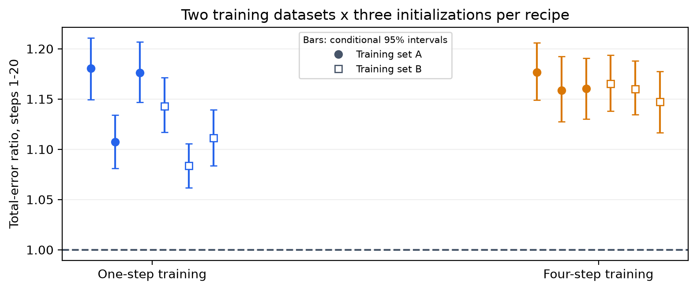
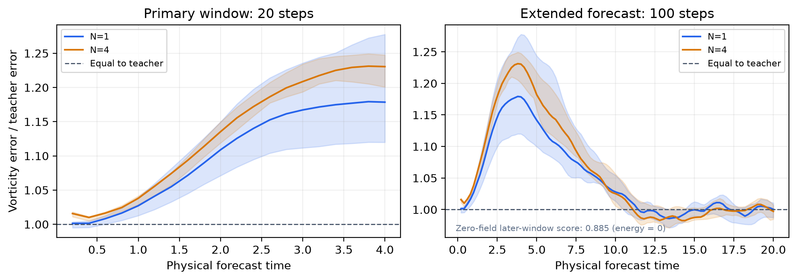
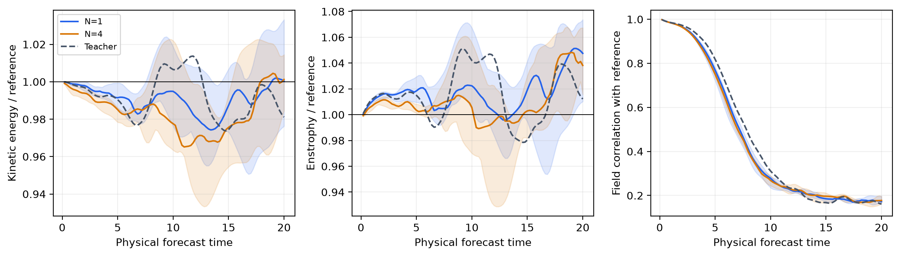
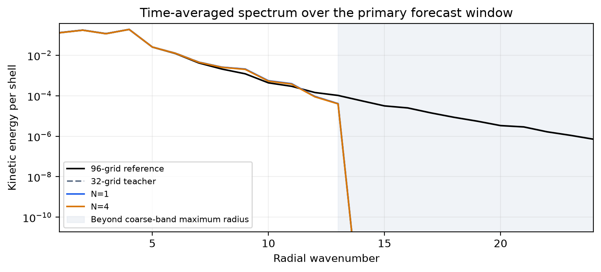
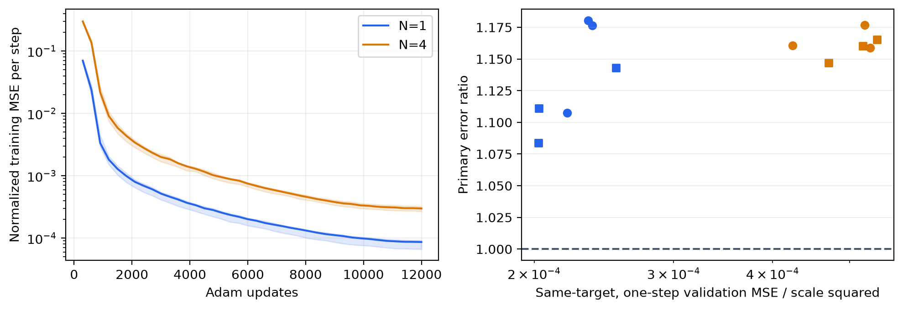
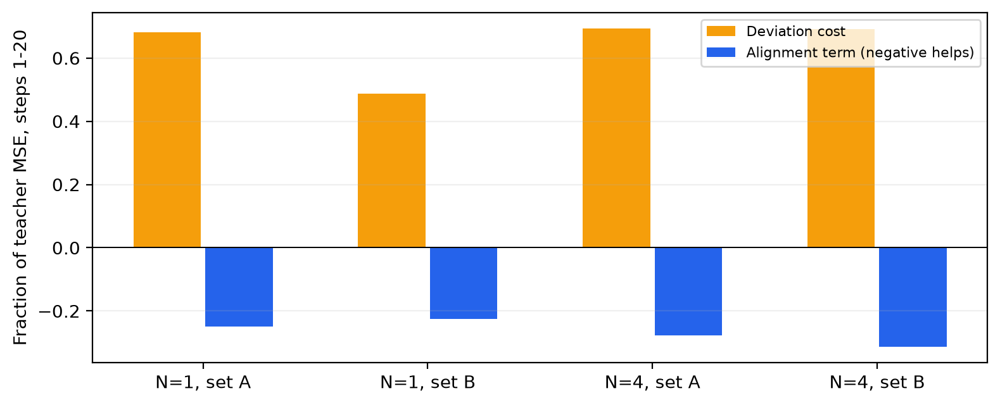
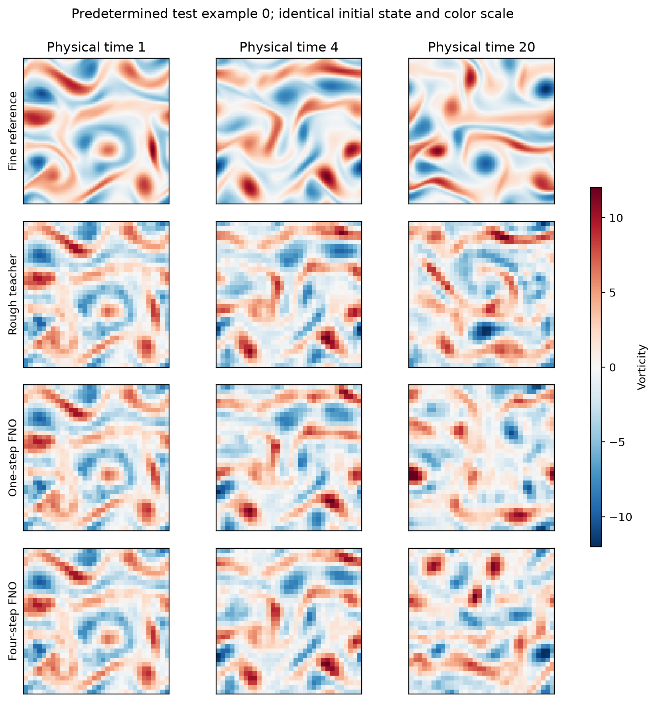

# 2D forced-flow extension results

Main outcomes: 12/12. Ratios below 1 favor the emulator. Failed/nonfinite outcomes retained in tables: 0. Curves show finite completed forecasts.

## Questions and fixed method

Compare coarse-only one-step and four-step FNO training on the same H=8 trajectories. There are two independent 128-flow training datasets and three initializations each. All main models use width 16, modes 10, four blocks, and 12,000 Adam updates. Testing uses 64 flows, a 32-grid teacher, a 96-grid reference, and a 128-grid refinement. See [the protocol](../../TURBULENCE_EXPERIMENT_PLAN.md) for preflight amendments and limitations.

## Main results

|   N |   training_data_seed |   models | R20                  | R100                 | velocity_R20         | full_field_R20       | models_better   |
|----:|---------------------:|---------:|:---------------------|:---------------------|:---------------------|:---------------------|:----------------|
|   1 |                 1101 |        3 | 1.176 [1.107, 1.180] | 1.042 [1.023, 1.045] | 1.275 [1.170, 1.299] | 1.144 [1.087, 1.148] | 0/3             |
|   1 |                 1102 |        3 | 1.111 [1.084, 1.143] | 1.026 [1.020, 1.033] | 1.173 [1.129, 1.226] | 1.091 [1.068, 1.116] | 0/3             |
|   4 |                 1101 |        3 | 1.160 [1.159, 1.177] | 1.031 [1.027, 1.051] | 1.264 [1.254, 1.293] | 1.131 [1.129, 1.144] | 0/3             |
|   4 |                 1102 |        3 | 1.160 [1.147, 1.165] | 1.033 [1.024, 1.036] | 1.257 [1.243, 1.272] | 1.130 [1.120, 1.134] | 0/3             |

Seed ranges are descriptive; bootstrap intervals are conditional on a frozen model. The shared test set is not multiplied by the number of trained models.

## Non-learning controls

| name            |      R20 |     R100 |   R21_100 |   velocity_R20 |
|:----------------|---------:|---------:|----------:|---------------:|
| zero            | 3.99082  | 1.04849  |  0.885307 |       6.68692  |
| persistence     | 4.03569  | 1.30047  |  1.14878  |       6.16358  |
| linear_flow     | 5.35635  | 2.44939  |  2.28817  |       7.66998  |
| space_refined48 | 0.120517 | 0.637521 |  0.666194 |       0.117643 |
| teacher         | 1        | 1        |  1        |       1        |
| time_refined32  | 0.999204 | 0.998724 |  0.998698 |       0.999196 |

## Paired training contrasts

|   dataset |   seed |   N1_R20 |   N4_R20 |   N4_minus_N1_R20 |   N1_R100 |   N4_R100 |   N4_minus_N1_R100 |
|----------:|-------:|---------:|---------:|------------------:|----------:|----------:|-------------------:|
|      1101 |      0 |  1.18038 |  1.17681 |       -0.00357103 |   1.04231 |   1.0506  |         0.00829649 |
|      1101 |      1 |  1.1075  |  1.15875 |        0.0512509  |   1.0228  |   1.03099 |         0.00819659 |
|      1101 |      2 |  1.17632 |  1.16049 |       -0.0158262  |   1.04476 |   1.02692 |        -0.0178418  |
|      1102 |      0 |  1.14303 |  1.16523 |        0.0221956  |   1.03336 |   1.03614 |         0.00277555 |
|      1102 |      1 |  1.08373 |  1.16012 |        0.0763967  |   1.02552 |   1.03315 |         0.00763047 |
|      1102 |      2 |  1.11113 |  1.14715 |        0.0360204  |   1.01977 |   1.02405 |         0.0042721  |

## All trained models

## Short and extended prediction

## Energy, enstrophy, correlation

## Energy across scales

## Imitation and optimization

## Squared-error decomposition

## Predetermined example

## Interpretation

All 12 prescribed models completed 12,000 updates and finite forecasts. None beats its teacher on the primary 20-step score. Across six models per recipe, the median error ratio is 1.127 for one-step training and 1.160 for four-step training.

Four-step training improves only two of six paired primary scores. Both recipes use the same underlying teacher trajectories, and the longer loss gives worse one-step teacher imitation at this fixed training budget. We find no reliable unrolling benefit in this setup.

The numerical controls locate the dominant error source: time refinement on the same 32-grid gives ratio 0.999, whereas a 48-grid solver gives 0.121. Spatial resolution matters much more than the selected time-step refinement here.

The trained models retain primary-window mean kinetic energy within 1% of the fine reference. Their extra prediction error is not caused by collapsing to zero. However, a zero-field control has later-window ratio 0.885, exposing how chaotic decorrelation can reward physically meaningless predictions.

## Report-ready paragraphs

We extended the emulator-superiority study to forced 2D incompressible Navier-Stokes flow in vorticity form. A 32-grid rough solver supplies all warmup, training, and validation states. A 96-grid reference, refined independently to 128 points per axis, is used only for evaluation. The comparison uses 64 held-out flows and 12 residual FNOs: two independent training datasets, three initializations each, and one-step or four-step losses on shared eight-step teacher trajectories. All models complete 12,000 updates. Unlike the earlier single-wave study, inputs contain multiple interacting modes and naturally varying heights.

We observe no primary emulator superiority in this 2D setup. Median integrated 20-step vorticity-error ratios are 1.127 for one-step training and 1.160 for four-step training, with all 12 models above 1 and all conditional test-bootstrap intervals above equality. Velocity and full-field metrics give the same qualitative conclusion. Four-step training improves only two of six paired primary scores and gives worse common-target one-step imitation. This identifies a boundary of the earlier 1D findings under a broader state distribution, without claiming that all 2D architectures or budgets must fail.

Evaluation-only numerical controls distinguish the teacher's error sources. Refining time integration on the same 32-grid leaves the primary error almost unchanged (ratio 0.999), whereas increasing spatial resolution to 48 points per axis reduces it to 0.121. The dominant tested discrepancy is spatial truncation, and the coarse-trained emulators do not reproduce the benefit of retaining additional modes. Their deviations partially oppose teacher error but introduce a larger squared-error cost, explaining why the measured cancellation does not produce overall superiority.

Physical diagnostics and a zero-field control qualify interpretation of long forecasts. The emulators keep primary-window mean kinetic energy within 1% of the fine reference, yet have worse pointwise predictions. A zero-field model, despite eliminating all energy, beats the teacher on the later-window pointwise score by about 11.5%. Thus broad 2D testing reveals both a robust negative result for the selected training protocol and a concrete failure mode of long-horizon superiority metrics. Joint checks of field accuracy, energy, enstrophy, spectra, and reference convergence are needed.

## Limitations

- One FNO architecture, one forcing pattern, and one physical parameter setting were tested. This is modest-Re forced flow (forcing-based Re=100), without a demonstrated inertial range or industrial-turbulence claim.

- Two training datasets and three initializations per dataset describe limited training variability. All models share 64 test flows; conditional bootstrap intervals do not make these independent additional datasets.

- Initial conditions come from rough-solver warmup and are identically interpolated into each fine solve. Generalization to a fine-solver stationary ensemble is untested. The reference is converged numerically, not exact continuum truth.

- The recipes share trajectories and update counts but differ in window weights, compute, and achieved imitation fit. The results do not prove that unrolling is intrinsically harmful.

- Long-horizon pointwise scores are affected by chaotic decorrelation. Lower error after forgetting the flow does not establish physical fidelity; good energy statistics likewise do not guarantee accurate trajectories.

- On the measured CPU implementation the FNO is about 1.9 times slower per forecast step than the rough solver, while being about 18 times faster than the fine reference. GPU or other implementation speedups were not tested.

## Numerical reference validation

{
  "config": {
    "coarse_points": 32,
    "reference_points": 96,
    "domain": 6.283185307179586,
    "viscosity": 0.01,
    "drag": -0.1,
    "forcing_mode": 4,
    "forcing_scale": 1.0,
    "output_dt": 0.2,
    "teacher_substeps": 10,
    "reference_substeps": 20,
    "warmup_steps": 300,
    "training_horizon": 8,
    "test_horizon": 100,
    "primary_horizon": 20,
    "hidden_channels": 12,
    "fno_modes": 8,
    "fno_blocks": 3
  },
  "test_flows": 64,
  "primary_steps": 20,
  "teacher_mean_resolved_RMSE_1_20": 0.9158965945243835,
  "refinement_mean_resolved_RMSE_1_20": 0.000646812841296196,
  "refinement_fraction_of_teacher_gap": 0.0007062072982080281,
  "refinement_max_RMSE_fraction_of_mean_teacher_gap": 0.004767901264131069,
  "reference_npz_sha256": "42325c65b35acf1e2fec92ca96b7796d031d3cc1bf53b6d06fb8219d5aaf6d2e",
  "unresolved_enstrophy_fraction_mean_1_20": 0.016515862196683884,
  "unresolved_kinetic_energy_fraction_mean_1_20": 0.0010817458387464285,
  "note": "All references are evaluation-only. Every fine solve starts with the same spectrally interpolated coarse field."
}

Sources: Exponax 0.1.0 and PDEquinox 0.1.2 installed source; https://fkoehler.site/exponax/api/stepper/nonlinear/navier_stokes/ ; https://arxiv.org/abs/2510.23111 . All new numbers come from this project’s artifacts.

## Longer reference check: fixed first-eight test subset

The primary reference check uses all 64 test flows; the following longer check uses only the predetermined first eight.

{
  "subset": "Predetermined first eight of the 64 test flows; same subset for all models.",
  "reference_refinement_fraction_of_teacher_gap_primary": 0.0010110404109582305,
  "reference_refinement_fraction_of_teacher_gap_later": 0.049197424203157425,
  "maximum_model_R100_change_on_subset": 0.0009900927543640137,
  "maximum_model_later_ratio_change_on_subset": 0.0010402798652648926,
  "zero_later_ratio_subset_reference96": 0.8654310703277588,
  "zero_later_ratio_subset_reference128": 0.8657989501953125
}
